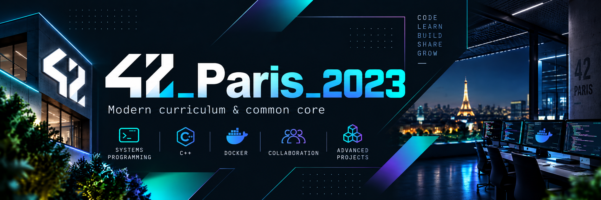

<p align="center">
  <a href="./README.md">🇬🇧 English</a> &nbsp;·&nbsp;
  <a href="./README.fr.md">🇫🇷 Français</a> &nbsp;·&nbsp;
  <strong>🇯🇵 日本語</strong>
</p>

<a id="top"></a>

<p align="center">
  
</p>

<h1 align="center">42 Paris · プロジェクト、アーカイブ、実験集</h1>

<p align="center">
  <strong>42 Parisでの学習の流れを、見やすく整理したハブです。</strong><br>
  <strong>2017年の基礎</strong>から<strong>2023年のCommon Core</strong>、さらに個人ツールや実験までをまとめています。
</p>

<p align="center">
  <a href="#-概要">概要</a> ·
  <a href="#-リポジトリを探索">探索</a> ·
  <a href="#-gitワークフロー">Gitワークフロー</a> ·
  <a href="#-assets--ドキュメント">Assetsとドキュメント</a>
</p>

---

## ✨ 概要

> `42_Paris` は1つのアプリではありません。**ネストされたGitリポジトリ／サブモジュールを集約したハブ**であり、**42 Paris**でのプロジェクト、学習アーカイブ、実験、ツールをまとめています。

<table>
<tr>
<td align="center" width="33%">
  <a href="https://github.com/Mechard-Organization/42_Paris_2017/tree/main_sub"></a>
  <br><br>
  <strong>🧱 42_Paris_2017</strong><br>
  <sub>初期カリキュラム、Piscine、最初の基礎学習。</sub>
</td>
<td align="center" width="33%">
  <a href="42_Paris_2023/"></a>
  <br><br>
  <strong>🚀 42_Paris_2023</strong><br>
  <sub>現代的なカリキュラム、Common Core、発展的な課題。</sub>
</td>
<td align="center" width="33%">
  <a href="https://github.com/Mechard-Organization/Others/tree/main_sub"></a>
  <br><br>
  <strong>🛠️ Others</strong><br>
  <sub>個人ツール、自動化、メモ、サイドプロジェクト。</sub>
</td>
</tr>
</table>

### 基本情報

- 🎓 **学校:** 42 Paris  
- 📚 **内容:** cursusアーカイブ、Common Coreプロジェクト、個人ツール、実験  
- 🧩 **構成:** ネストされたGitリポジトリ / サブモジュール  
- 🏁 **節目:** 2023 Common Core を **2026年2月26日** に修了  
- 🌍 **ドキュメント:** **英語・フランス語・日本語** で利用可能

---

## 🧭 リポジトリを探索

### 全体構成

```text
42_Paris/
├── 42_Paris_2017/
│   ├── Piscine_C_2017/
│   └── Cursus_2017/
├── 42_Paris_2023/
│   ├── Association_2023/
│   │   ├── BDE/
│   │   └── Blackout/
│   ├── Piscine_C_2023/
│   └── Cursus_2023/
│       ├── Common_Core/
│       │   ├── Cpp/
│       │   └── ...
│       ├── Post_Common_Core/
│       │   ├── Realeased/
│       │   └── Unrealeased/
│       │       ├── Darkly/
│       │       ├── libasm/
│       │       ├── snow-crash/
│       │       └── Intership_I_video/
│       └── Tools/
│           └── Complete_libft ✅/
├── Others/
│   ├── École_42/
│   └── Perso/GC/
└── .assets/
    ├── docs/
    ├── images/
    ├── text/
    └── tree/
```

詳細なツリー一覧：
- [`42_Paris_2017`](.assets/tree/42_Paris_2017.md)
- [`42_Paris_2023`](.assets/tree/42_Paris_2023.md)
- [`Others`](.assets/tree/Others.md)

---

## 🧱 42_Paris_2017

<p align="center"></p>

**2017年の章**は、42での最初の学習記録です。Piscine、最初のCプロジェクト、Unixの基礎、そして開発の初期段階を記録しています。

| 項目 | 内容 |
| :--- | :--- |
| **Piscine C** | 日々の演習、rush、基礎練習 |
| **Cプログラミング** | 42の初期定番課題、基礎的なアルゴリズム学習 |
| **アーカイブ価値** | 学習の成長や昔の構成を振り返るための記録 |

---

## 🚀 42_Paris_2023

<p align="center"></p>

**2023年のセクション**は、より現代的で構造化された学習フェーズです。Common Coreを中心に、より大きく技術的な課題へ進んでいきます。

| 項目 | 内容 | リンク |
| :--- | :--- | :--- |
| **Piscine C / Shell** | 42の学習モデルへの再スタート | [open](42_Paris_2023/Piscine_C_2023/) |
| **Common Core** | 基礎プログラミング、システム、グラフィックス、ネットワーク、協業 | [open](42_Paris_2023/Cursus_2023/Common_Core/) |
| **Post_Common_Core** | Common Core後の追加プロジェクト | [open](42_Paris_2023/Cursus_2023/Post_Common_Core/) |
| **Tools** | 補助ツールや再利用可能なユーティリティ | [open](42_Paris_2023/Cursus_2023/Tools/) |
| **Associations** | 学校生活・団体関連の資料 | [open](42_Paris_2023/Association_2023/) |

### 代表的なプロジェクト群

- **C基礎**: `libft_125`, `ft_printf_110`, `get_next_line_112`
- **アルゴリズム / プロセス**: `push_swap_100`, `pipex_115`, `philo_100`, `minishell_101`
- **グラフィックス**: `So_long_96`, `Cub3D_105`
- **C++**: `Cpp`, `cpp00_80` → `cpp09_100`
- **システム / インフラ**: `Born2beroot_125`, `Netpractice_100`, `IRC_125`, `Inception_100`
- **Web / 協業**: `42_collaborative_resume_100`, `ft_transcendence_125`

### Post–Common Core：新しいディレクトリ構成

Post–Common Core のプロジェクトは、以前の `Projects/Post_CC/` ではなく、[`Cursus_2023/Post_Common_Core/`](42_Paris_2023/Cursus_2023/Post_Common_Core/) の直下にまとめられています。

| フォルダ | 内容 |
| :--- | :--- |
| [`Realeased/`](42_Paris_2023/Cursus_2023/Post_Common_Core/Realeased/) | このアーカイブには `tmp` ファイルが含まれています（実際のスペルを維持） |
| [`Unrealeased/`](42_Paris_2023/Cursus_2023/Post_Common_Core/Unrealeased/) | [`Darkly`](42_Paris_2023/Cursus_2023/Post_Common_Core/Unrealeased/Darkly/)、[`libasm`](42_Paris_2023/Cursus_2023/Post_Common_Core/Unrealeased/libasm/)、[`snow-crash`](42_Paris_2023/Cursus_2023/Post_Common_Core/Unrealeased/snow-crash/) |

この一覧は**提供されたアーカイブ内のフォルダ構成**を示しており、各プロジェクトの完了や評価状況を意味するものではありません。`Realeased` と `Unrealeased` の表記は実際のパスに合わせています。


---

## 🛠️ Others

<p align="center"></p>

`Others/` はこのリポジトリの**実験ゾーン**です。個人ツール、シェル補助、Git自動化、学習メモ、サイドプロジェクトが入っています。

| フォルダ | 役割 |
| :--- | :--- |
| `École_42/` | 学校関連の個人リソース |
| `Perso/GC/` | カスタムGitコマンド、シェルツール、補助スクリプト |
| その他 | 個人プロジェクトと実験 |

---

## 🔀 Gitワークフロー

<p align="center"></p>

このリポジトリは**ネストされたサブモジュール**で構成されているため、Gitワークフローが重要です。

### 標準の再帰クローン

```bash
git clone --recurse-submodules git@github.com:Mechard-Organization/42_Paris.git
cd 42_Paris
```

### すでにサブモジュールなしでクローンしている場合

```bash
git submodule update --init --recursive
```

### 個人用Zshラッパーを使う場合

```bash
git clone git@github.com:Mechard-Organization/42_Paris.git
git add -A
git commit -m "Your message"
git push
```

このカスタムラッパーでは次が可能です：
- サブモジュール / サブサブモジュールの再帰クローン
- ブランチ整列（`main_42_Paris`, `main_sub`, `main`）
- ネストされたリポジトリの準備
- 子から親への順でcommit
- 実際に変更があるリポジトリだけpush
- 読みやすいログ管理

📘 詳細は [`.assets/docs/GIT_WORKFLOW.md`](.assets/docs/GIT_WORKFLOW.md) を参照してください。

---

## 🗂️ Assets & ドキュメント

<p align="center"></p>

README関連のすべてのリソースは `.assets/` に集約されています。

| リソース | 場所 |
| :--- | :--- |
| Repository guide | [`.assets/docs/REPOSITORY_GUIDE.md`](.assets/docs/REPOSITORY_GUIDE.md) |
| Git workflow guide | [`.assets/docs/GIT_WORKFLOW.md`](.assets/docs/GIT_WORKFLOW.md) |
| Assets guide | [`.assets/docs/ASSETS.md`](.assets/docs/ASSETS.md) |
| README画像 | [`.assets/images/`](.assets/images/) |
| ツリー記録 | [`.assets/tree/`](.assets/tree/) |
| テキストエクスポート | [`.assets/text/`](.assets/text/) |

---

## 💡 このリポジトリの価値

このリポジトリは、
- **42での技術的アーカイブ**であり、
- **ネストされたリポジトリへのナビゲーションハブ**であり、
- **実験とツール開発のための生きたワークスペース**でもあります。

---

<p align="center"><a href="#top">⬆️ トップへ戻る</a></p>
