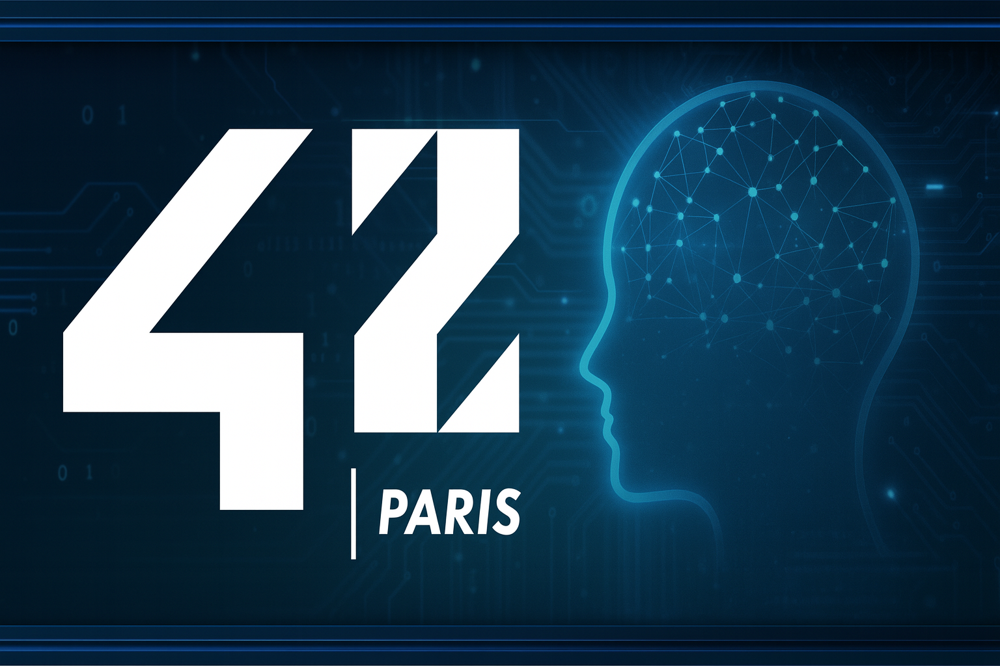
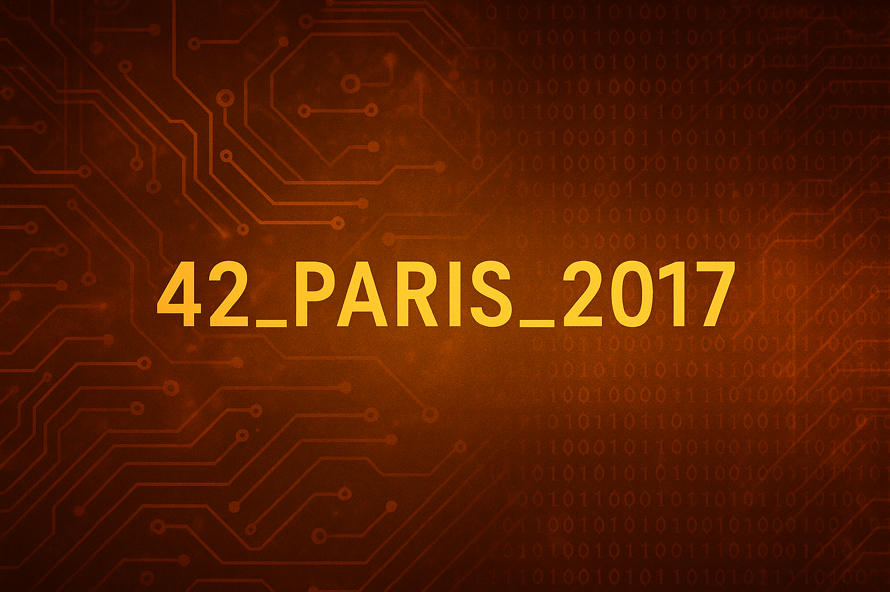
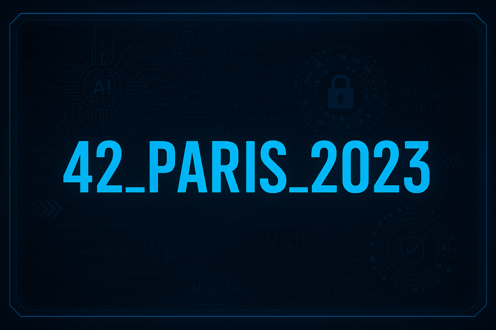

<p align="center">
  🌐 <strong>Languages:</strong>
  <strong>🇬🇧 English</strong> &nbsp;·&nbsp;
  <a href="./README.fr.md">🇫🇷 Français</a> &nbsp;·&nbsp;
  <a href="./README.ja.md">🇯🇵 日本語</a>
</p>

<a id="top"></a>

<div align="center">

<a href="https://github.com/Mechard-Organization/42_Paris">
  
</a>

# 42 Paris · Projects & Learning Archive

**Two chapters at 42 Paris. One evolving collection of code, experiments and tools.**

From the **2017 Piscine** to the **2023 curriculum**, this repository brings together my training projects, technical experiments and the tooling I use to maintain them.

**[Explore the repository](#explore)** · **[2023 projects](#journey-2023)** · **[2017 archive](#journey-2017)** · **[Git workflow](#git-workflow)**

<sub>Maintained by <strong>Maxime Echard</strong> · École 42 Paris</sub>

</div>

---

## Welcome

`42_Paris` is my central workspace for projects and learning materials from **École 42 Paris**. It combines an earlier coding journey in **2017**, a new curriculum started in **2023**, and the personal projects and utilities developed alongside them.

The repository is a **collection of Git repositories connected through nested submodules**, not a single monolithic application. Individual projects retain their own source code, history and, where applicable, documentation.

> **Milestone:** I completed the **2023 Common Core on 26 February 2026**. The repository also contains historical work, experiments and post–Common Core material; the presence of a project does not necessarily imply a particular validation status.


<a id="explore"></a>

## Explore the repository

<table>
<tr>
  <td align="center" width="33%">
    <a href="42_Paris_2017/"></a>
    <br><strong><a href="42_Paris_2017/">42 Paris · 2017</a></strong>
    <br><sub>Piscine C, first steps and early curriculum projects.</sub>
  </td>
  <td align="center" width="33%">
    <a href="42_Paris_2023/"></a>
    <br><strong><a href="42_Paris_2023/">42 Paris · 2023</a></strong>
    <br><sub>Piscine, Common Core, later projects and student life.</sub>
  </td>
  <td align="center" width="33%">
    <a href="Others/"></a>
    <br><strong><a href="Others/">Others</a></strong>
    <br><sub>Personal learning, experiments, notes and Git utilities.</sub>
  </td>
</tr>
</table>

### Repository map

```text
42_Paris/
├── 42_Paris_2017/
│   ├── Piscine_C_2017/          # 2017 Piscine exercises and subjects
│   └── Cursus_2017/            # Early projects and learning material
├── 42_Paris_2023/
│   ├── Piscine_C_2023/          # C and Shell Piscine exercises
│   ├── Cursus_2023/
│   │   └── Projects/
│   │       ├── Common_core/     # Core curriculum and nested repositories
│   │       ├── Post_CC/         # Work beyond the Common Core
│   │       └── Tools/           # Supporting utilities
│   └── Association_2023/       # Student association material
├── Others/
│   ├── École_42/                # Personal school resources
│   └── Perso/GC/               # Custom Git tooling
└── .assets/
    ├── docs/                    # Supporting repository documentation
    ├── images/                  # All README images
    ├── text/                    # Text-based tree exports
    └── tree/                    # Detailed tree snapshots
```

The map intentionally shows **navigation landmarks**, rather than every exercise and nested repository. Explore the [extended directory guide](.assets/docs/REPOSITORY_GUIDE.md), or consult the existing tree snapshots: [2017](.assets/tree/42_Paris_2017.md) · [2023](.assets/tree/42_Paris_2023.md) · [Others](.assets/tree/Others.md).

---

<a id="journey-2023"></a>

## The 2023 journey

<p align="center"><a href="42_Paris_2023/"></a></p>

The 2023 section documents my return to the school curriculum: the **Piscine**, projects in the **Common Core**, later work and participation in student activities.

| Area | What you will find | Browse |
| :--- | :--- | :--- |
| **Piscine C** | Shell exercises, C modules and rush projects | [Piscine_C_2023](42_Paris_2023/Piscine_C_2023/) |
| **Common Core** | Programming fundamentals, algorithms, systems, networking and team projects | [Common_core](42_Paris_2023/Cursus_2023/Projects/Common_core/) |
| **Post–Common Core** | Additional and advanced projects | [Post_CC](42_Paris_2023/Cursus_2023/Projects/Post_CC/) |
| **Tools** | Utilities and reusable project support | [Tools](42_Paris_2023/Cursus_2023/Projects/Tools/) |
| **Associations** | BDE and Blackout material | [Association_2023](42_Paris_2023/Association_2023/) |

### Selected Common Core projects

The following projects and folders are present in the supplied repository snapshot. Their names preserve the original repository organization.

| Focus | Projects |
| :--- | :--- |
| **C foundations & I/O** | [`libft_125`](42_Paris_2023/Cursus_2023/Projects/Common_core/libft_125/), [`ft_printf_110`](42_Paris_2023/Cursus_2023/Projects/Common_core/ft_printf_110/), [`get_next_line_112`](42_Paris_2023/Cursus_2023/Projects/Common_core/get_next_line_112/) |
| **Algorithms & process management** | [`push_swap_100`](42_Paris_2023/Cursus_2023/Projects/Common_core/push_swap_100/), [`pipex_115`](42_Paris_2023/Cursus_2023/Projects/Common_core/pipex_115/), [`philo_100`](42_Paris_2023/Cursus_2023/Projects/Common_core/philo_100/), [`minishell_101`](42_Paris_2023/Cursus_2023/Projects/Common_core/minishell_101/) |
| **Graphics** | [`So_long_96`](42_Paris_2023/Cursus_2023/Projects/Common_core/So_long_96/), [`Cub3D_105`](42_Paris_2023/Cursus_2023/Projects/Common_core/Cub3D_105/) |
| **C++** | [`Cpp`](42_Paris_2023/Cursus_2023/Projects/Common_core/Cpp/) — modules `cpp00_80` through `cpp09_100` as available in the archive |
| **Systems & networking** | [`Born2beroot_125`](42_Paris_2023/Cursus_2023/Projects/Common_core/Born2beroot_125/), [`Netpractice_100`](42_Paris_2023/Cursus_2023/Projects/Common_core/Netpractice_100/), [`IRC_125`](42_Paris_2023/Cursus_2023/Projects/Common_core/IRC_125/), [`Inception_100`](42_Paris_2023/Cursus_2023/Projects/Common_core/Inception_100/) |
| **Collaboration & web** | [`42_collaborative_resume_100`](42_Paris_2023/Cursus_2023/Projects/Common_core/42_collaborative_resume_100/), [`ft_transcendence_125`](42_Paris_2023/Cursus_2023/Projects/Common_core/ft_transcendence_125/) |

For a complete folder-by-folder view, see the [2023 navigation guide](.assets/docs/REPOSITORY_GUIDE.md#2023-curriculum).

---

<a id="journey-2017"></a>

## The 2017 journey

<p align="center"><a href="42_Paris_2017/"></a></p>

My first chapter at 42: an archive of early **C programming and Unix fundamentals**, intensive Piscine exercises and initial curriculum projects. This material is preserved as a record of how the journey began.

| Area | Contents |
| :--- | :--- |
| **[Piscine C 2017](42_Paris_2017/Piscine_C_2017/)** | Daily exercises, C practice and subject files |
| **[Cursus 2017](42_Paris_2017/Cursus_2017/)** | `libft`, `get_next_line`, `ft_printf`, `fillit`, `fdf`, `fract_ol`, `docker-1`, `init`, `piscine_reloaded` and other early material |

The 2017 section is primarily a **historical archive**. Its contents, conventions and dependencies may differ from the later curriculum.

---

## Personal work & tools

<p align="center"><a href="Others/"></a></p>

[`Others/`](Others/) holds material developed beyond the formal course requirements: extra learning resources, scripts, experiments and practical utilities.

| Location | Purpose |
| :--- | :--- |
| [`École_42/`](Others/%C3%89cole_42/) | Additional school resources, exercises and reference material |
| [`Perso/GC/`](Others/Perso/GC/) | Personal Git helpers and shell configuration |
| [`Perso/`](Others/Perso/) | Other personal workspace material |

**Note:** This is an archive of personal work, so individual folders may have different documentation, maintenance levels and visibility settings.

---

<a id="git-workflow"></a>

## Working with this repository

### Clone all nested submodules

The repository contains **nested Git submodules**. A regular `git clone` alone does not necessarily fetch their working trees.

**Standard Git** — works in Bash, Zsh and other shells:

```bash
git clone --recurse-submodules git@github.com:Mechard-Organization/42_Paris.git
cd 42_Paris
```

Already cloned without submodules?

```bash
git submodule update --init --recursive
```

**Personal Zsh setup** — when the custom wrapper from this workspace has been installed, the exact command below additionally configures its recursive workflow and branch alignment:

```bash
git clone git@github.com:Mechard-Organization/42_Paris.git
```

The special behavior is **not part of Git itself**. Without the Zsh wrapper, use the standard recursive clone above.

### Branches & commits

The personal wrapper aligns the repository to `main_42_Paris` and uses `main_sub` when present in a submodule, otherwise `main`. Because Git normally checks out submodules at **recorded commits**, branch alignment and subsequent commits can update the parent repository's submodule pointers (*gitlinks*).

When the wrapper is active, its publish workflow is:

```bash
git add -A
git commit -m "Describe the changes"
git push
```

The wrapper traverses the nested repositories, commits affected repositories **from children to parents**, and pushes only repositories with local commits to publish. After each push attempt, a new `add → commit` cycle is required.

> **Review before committing.** The custom `git add -A` affects **all initialized repositories** in this workspace, even when invoked from a nested folder. Check `git status` or `git diff --cached` in affected repositories before committing, particularly when working with local or personal material. Avoid storing credentials or other secrets in commits.

For the full command matrix, safety notes, examples and log location, see **[Git workflow & wrapper guide](.assets/docs/GIT_WORKFLOW.md)**.

---

## Documentation & assets

All resources used by **this README** are kept in the root-level [`.assets/`](.assets/) directory: **images, supporting Markdown/text documents and existing directory-tree exports**. The README does not depend on externally hosted badge or image services.

| Resource | Location |
| :--- | :--- |
| Repository guide and Git workflow | [`.assets/docs/`](.assets/docs/) |
| Banners, profile artwork and other images | [`.assets/images/`](.assets/images/) |
| Existing plain-text trees | [`.assets/text/`](.assets/text/) |
| Existing Markdown tree snapshots | [`.assets/tree/`](.assets/tree/) |
| Asset organization and maintenance notes | [`.assets/docs/ASSETS.md`](.assets/docs/ASSETS.md) |

The deeper folders keep their own READMEs, source files and project-specific resources. `.assets/` centralizes the **root README's supporting material**; it does not relocate source code or rewrite independent submodules.

---

<div align="center">


**Maxime Echard** · 42 Paris

*Learning by building, breaking things, understanding them and building again.*

[Back to the top ↑](#top)

</div>
